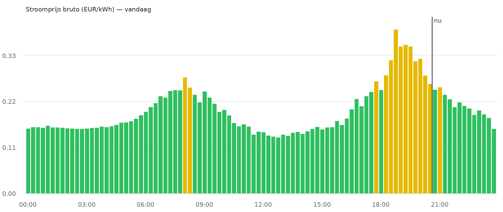
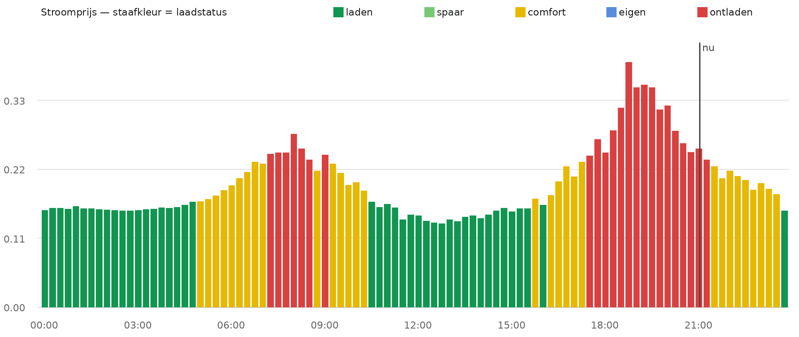

# ⚡ Energyprijs

**Eén klik (of één service-call) plant het complete dynamische-stroomprijs-package in Home Assistant.**

| Wat je krijgt | Details |
|---|---|
| 🔀 3 bronnen, kruiscontrole | Nord Pool · EnerPrice · EnergyZero — basisprijs faalt als <2 bronnen vers zijn |
| 📊 Bruto daglijst (15 min) | Direct grafiekklaar voor ApexCharts-card, vandaag + morgen |
| 💶 All-in formules | Afname/levering via instelbare velden: btw, energiebelasting, opslagen |
| 🔔 Meldingen | Automatisch bij bronuitval, spreiding of ontbrekende morgenprijzen |
| 🗓️ 2027-bestendig | Saldering vervalt 1-1-2027 → één schakelaar om, formules passen zichzelf aan |
| 🔋 Shadow tactiek (v1.5.1) | Regime-vrije accuhandel met vijf statussen: Laden, Neutraal, Spaar, Doorleveren en Ontladen. Neutraal is sinds v1.8.4 de verbruiksband — wanneer de prijs te duur is om te laden en te goedkoop om te verkopen (η round-trip inbegrepen), voert de accu het huis. |

## Installatie

### Stap 0 — Integratie toevoegen (UI, één klik)

Ga naar **Instellingen → Apparaten en services → Integratie toevoegen → "Energyprijs"**
en bevestig. Het config-flow plant daarna zelf het package + de contract-helpers
(geen service-aanroep nodig). Na één HA-herstart zijn alle sensoren en helpers aanwezig.

> Wil je liever de service-route (bv. vóór herstart), dan is **Stap 2** de aanroep.

### Stap 1 — HACS
1. **HACS → ⋮ → Custom repositories → Add repository**
   - Repository: `janvdberg/energyprijs` (of de URL van deze repo)
   - Category: **Integration**
2. Zoek **Energyprijs** → **Download**
3. **Herstart Home Assistant**

### Stap 2 — Installeren
Developer Tools → Actions (Service):

```yaml
action: energyprijs.install
data: {}
```

De installer doet dan automatisch:

| # | Actie | Veiligheid |
|---|---|---|
| 1 | Package (re)schrijven naar `/config/packages/energyprijs.yaml` | Overschrijft alleen dit bestand |
| 2 | Controleren of de package wordt geladen (status `ok` / `ui_only` / `handmatig`) | configuration.yaml wordt **nooit** herschreven — bij `handmatig` volgt een plakinstructie |
| 3 | Melden dat herstart nodig is | Forceert niets — jij kiest het moment |

Optioneel: `force_restart: true` meesturen als je de herstart meteen wilt.

### Stap 3 — Controleren

```yaml
action: energyprijs.status
```

Toont of package + include aanwezig zijn.

## Voorwaarden

De package gebruikt sensoren van integraties die al geïnstalleerd moeten zijn —
**minstens één** prijsbron is vereist, zonder bron blijven de sensoren `unavailable`:

- **Nord Pool** (core-integratie)
- **EnerPrice** (HACS: `LenFaki/home-assistant-nl-day-ahead-prices`) — zet *extended attributes* aan in de opties (aanbevolen)
- **EnergyZero** (core-integratie)
- Een notify-service (mobiele app, Telegram, `persistent_notification`). Vul diens
  naam in zonder `notify.`-voorvoegsel in `input_text.prijs_notify_doel`; leeg of
  niet-geresolveerd (`unknown`/`unavailable`, bijv. rond een herstart) = automatisch
  persistent notification, dus niets faalt als je dit overslaat (sinds v1.7.9)

> De basisprijs vereist **twee** verse bronnen (kruiscontrole); met één bron
> blijft de daglijst beschikbaar maar wordt de basis unavailable. Heb je alleen
> Zonneplan-forecast draaien? Voeg dan Nord Pool óf EnergyZero toe
> (beide core-integraties, twee klikken).

## Entiteiten na installatie

```
sensor.prijzen_bron_nordpool          sensor.stroomprijs_basis
sensor.prijzen_bron_enerprice         sensor.stroomprijs_daglijst
sensor.prijzen_bron_energyzero        sensor.stroomprijs_afname
                                    sensor.stroomprijs_levering
binary_sensor.prijzen_kruiscontrole_afwijking
binary_sensor.prijzen_morgen_beschikbaar
input_number.prijs_btw / _energiebelasting / _opslag_afname / _opslag_levering / _afwijkingsdrempel / _laad_drempel
input_boolean.prijs_saldering_energiebelasting_teruggave
input_text.accu_bron_entity           sensor.energyprijs_accu_percentage (snelkoppeling)
input_number.accu_capaciteit_kwh / _vermogen_in_kw / _vermogen_uit_kw / _accu_reserve_pct  → sensor.energyprijs_accu_reserve (kWh)
input_text.pv_bron_vandaag / _pv_bron_morgen   sensor.energyprijs_pv_vandaag / _pv_morgen (snelkoppelingen)
automation.prijzen_*  (2 meld-automatiseringen)
```

## Jouw contract: invulvelden (helpers)

De formules voor inkoop en verkoop zijn **niet** voor iedereen gelijk — alleen de bruto spotprijs is dat. Daarom staan alle contractafhankelijke getallen in aanpasbare helpers (**Instellingen → Automatiseringen & scenes → Helpers**), die het package bij installatie aanmaakt met neutrale startwaarden:

| Helper | Betekenis | Formule-role |
|---|---|---|
| `input_number.prijs_btw` | btw-percentage (NL: 0,21) | ×(1+btw) in beide formules |
| `input_number.prijs_energiebelasting` | energiebelasting excl. btw (EUR/kWh) | inkoopprijs; vervalt per 1-1-2027 grotendeels |
| `input_number.prijs_opslag_afname` | leveranciersopslag afname (EUR/kWh) | inkoopprijs — **jouw leverancier, niet van mij** |
| `input_number.prijs_opslag_levering` | leveranciersopslag levering (EUR/kWh) | verkoopprijs |
| `input_boolean.prijs_saldering_energiebelasting_teruggave` | saldering aan/uit | per 1-1-2027 uitzetten → formule past zichzelf aan |

Formules: **inkoop** = (bruto + opslag_afname + energiebelasting) × (1+btw) · **verkoop** = (bruto + opslag_levering) × (1+btw) (+ belasting-teruggave zolang saldering aan staat).

Vul na installatie de waarden in die op **jouw contract** slaan (te vinden in je leveringsvoorwaarden of op je factuur); de sensoren `sensor.stroomprijs_afname` / `_levering` rekenen dan direct mee. De startwaarden in het package zijn indicatief — pas ze aan, anders kloppen inkoop/verkoop niet voor jouw situatie.

### Instellingen-tegel op je dashboard

Plak deze kaart om de velden direct bij te stellen

```yaml
type: entities
title: Stroomprijs — contractinstellingen
show_header_toggle: false
state_color: true
entities:
  - entity: input_number.prijs_btw
    name: Btw (factor, NL = 0,21)
  - entity: input_number.prijs_energiebelasting
    name: Energiebelasting excl. btw (€/kWh)
  - entity: input_number.prijs_opslag_afname
    name: Leveranciersopslag afname (€/kWh)
  - entity: input_number.prijs_opslag_levering
    name: Leveranciersopslag levering (€/kWh)
  - entity: input_boolean.prijs_saldering_energiebelasting_teruggave
    name: Saldering (teruggave belasting)
```

✅ **Volledig dynamisch:** de prijs-sensoren hebben state-triggers op hun contract-helpers. Verzet btw, energiebelasting, een opslag of zet saldering om — `sensor.stroomprijs_afname` / `_levering` (en de EnergyZero-bron) herberekenen **direct**, zonder herstart en zonder package-reload; de prijs-tegels en de daglijst-gaten lopen binnen een paar seconden mee.

### Accu-contract: de snelkoppeling naar jóuw accu (v1.2.42)

De meeste huizen hebben allang een accu-percentage-entity — alleen heet die bij de één
`sensor.solarman_battery_soc`, bij de ander `sensor.battery`. Het package lost dat op met
één vaste, botsingvrije naam plus één invulveld:

| Helper | Betekenis |
|---|---|
| `input_text.accu_bron_entity` | entity_id van jouw SOC-sensor (plakken of via de entiteitenkiezer). Leeg → `sensor.energyprijs_accu_percentage` is unavailable en de tegel toont "Geen bron ingesteld" |
| `input_number.accu_capaciteit_kwh` | accucapaciteit — maakt %→kWh mogelijk |
| `input_number.accu_vermogen_in_kw` / `_uit_kw` | max laad-/ontlaadvermogen — deurtijd-berekening |

`sensor.energyprijs_accu_percentage` is een state-based template-sensor en volgt de
gekozen bron **live**: HA triggert op elke entiteit die tijdens het renderen met
`states()` wordt gelezen — dus óók de dynamisch gekozen bron-entiteit. Vul iets anders
in of laat je SOC veranderen, de tegel en elke formule lopen direct mee. Elk dashboard,
elke automatisering en elke formule verwijst alleen naar `sensor.energyprijs_accu_percentage`
— nooit naar de bron van iemand anders. De prefix voorkomt een naambotsing met een
bestaande `sensor.accu_percentage` in jouw setup. Zelfverwijzing (het veld bevat de
sensor zelf) wordt gedetecteerd → unavailable, geen lus. De drie getal-helpers krijgen
bij de allereerste installatie conservatieve startwaarden (10 kWh / 5 kW); verzet ze
naar jouw accu.

| Helper | Betekenis |
|---|---|
| `input_text.pv_bron_vandaag` | entity_id van jouw PV-forecast-sensor voor vandaag (bijv. `sensor.<forecast_solar>_energy_production_today_remaining`). Leeg → `sensor.energyprijs_pv_vandaag` is unavailable en de tegel toont "Geen bron ingesteld" |
| `input_text.pv_bron_morgen` | entity_id van jouw PV-forecast-sensor voor morgen (bijv. `sensor.<forecast_solar>_energy_production_tomorrow`). Leeg → `sensor.energyprijs_pv_morgen` is unavailable |

`sensor.energyprijs_pv_vandaag` en `sensor.energyprijs_pv_morgen` zijn state-based
template-sensoren en volgen de gekozen bron **live** — exact hetzelfde patroon als de
accu-snelkoppeling. In de `pvcontract`-tegel zie je de verwachte kWh en een schatting
van de extra verkoopwaarde op basis van jouw `prijs_opslag_levering` + `prijs_btw`.

## Dashboard in één keer

### Weg 1: automatisch — eigen dashboard, compleet gevuld

Roep de service `energyprijs.dashboard` aan. Makkelijkste vindplaats:

- **Instellingen → Apparaten en services → Integraties → tegel "Energyprijs"** → onderaan
  staat bij *Services* een directe link **`energyprijs.dashboard`** (en `.cards`, `.install`,
  `.status`) → klik → velden leeg laten → **Action**.
- Of Developer Tools → Actions (linkerbovenhoek ☰ → Developer Tools → tab Actions) → typ
  `energyprijs.dashboard`.

Beide routes werken; de integratietegel is het duidelijkst omdat hij de services letterlijk
toont. (Zet na een HACS-upgrade eerst de integratie opnieuw uit/in of herstart HA — dan
verschijnen nieuwe services ook in die lijst.)

Dan:
- **bestaat het dashboard niet** → er wordt een nieuw user dashboard **"Energie"**
  aangemaakt met de prijs-tegels (inkoop/verkoop), de inkoop-/verkoopgrafiek en de
  contractinvulvelden. Het verschijnt direct in je dashboardmenu;
- **bestaat het dashboard al** → de kaarten worden bijgewerkt naar de opbouw uit de
  huidige versie. **Andere kaarten in het dashboard blijven 100% intact.**

Na een HACS-upgrade herbouwt het dashboard zichzelf automatisch bij de volgende
herstart (of via de 5-minutencheck) — er hoeft niets handmatig aangeroepen te worden.
Handmatig aangepaste kaarten van de integratie zelf worden dan vervangen door de
opbouw uit de repo (golden file, `tests/golden_dashboard.yaml`); wil je iets anders,
pas dan `cards.py` in de repo aan.

### Weg 2: handmatig — kaarten in je bestaande dashboard

Liever zelf bepalen waar de kaarten komen? Roep **`energyprijs.cards`** aan
(Developer Tools → Actions, Response data aan) en plak de vijf YAML-blokken
(`nu` + `grafiek` + `contract` + `accueenheden` + `accucontract`) via **Add card →
Show code editor** in je eigen dashboard — in die volgorde. De grafiek vereist de
HACS-kaart `apexcharts-card`; de tegels zijn pure core.

## Zo ziet je dashboard er daarna uit



*Inkoop- en verkoopprijs als tegels boven de grafiek (2-koloms grid). Daaronder 15-min balkjes van de inkoopprijs all-in; donkergroen < €0,10 · lichtgroen < €0,25 · geel < €0,40 · rood ≥ €0,40 — en onder de balkjes een dun rood lijntje voor de verkoopprijs. Geen legenda: balk = inkoop, lijn = verkoop. De gestippelde lijn is 'nu'. Ten slotte de contract-tegel. Dit is een nabouwing met echte data van vandaag — in HA tekent ApexCharts-card exact dit beeld, inclusief hover-waarden per kwartier.*

## Grafiek — handmatig plakken

Weg 2 (handmatig) plak je deze grafiekkaart zelf in een dashboard
(vereist `custom:apexcharts-card` via HACS). Dit is exact de kaart die de
integratie zelf genereert:

```yaml
type: custom:apexcharts-card
section_mode: true
experimental:
  color_threshold: true
graph_span: 24h
span:
  start: day
update_interval: 5min
show:
  last_updated: true
now:
  show: true
  label: nu
header:
  show: true
  title: Stroomprijs
  show_states: false
  colorize_states: false
series:
  # ── balkjes = inkoopprijs all-in per kwartier, gekleurd op prijsniveau ──
  - entity: sensor.stroomprijs_daglijst
    name: inkoop
    type: column
    yaxis_id: prijzen
    data_generator: >
      return entity.attributes.vandaag.concat(entity.attributes.morgen).map((e) => [new Date(e.t).getTime() + 450000, e.in]);
    float_precision: 3
    color_threshold:
      - value: 0
        color: "#0a8f3c"
      - value: 0.1
        color: "#2fbf5f"
      - value: 0.25
        color: "#e6b800"
      - value: 0.4
        color: "#d94040"
    show:
      in_header: false
  # ── dun lijntje onder de balkjes = verkoopprijs all-in ──
  - entity: sensor.stroomprijs_daglijst
    name: verkoop
    type: line
    yaxis_id: prijzen
    stroke_width: 1
    color: "#d94040"
    data_generator: >
      return entity.attributes.vandaag.concat(entity.attributes.morgen).map((e) => [new Date(e.t).getTime() + 450000, e.uit]);
    float_precision: 3
    show:
      in_header: false
apex_config:
  legend:
    show: false
  xaxis:
    # as loopt een halve kolom verder dan de dag → eerste/laatste staafje volledig zichtbaar
    min: EVAL:new Date(new Date().setHours(0,0,0,0)).getTime() - 450000
    max: EVAL:new Date(new Date().setHours(23,59,59,999)).getTime() + 450000
yaxis:
  - decimals: 3
    min: '|-0.04|'
    max: '|+0.04|'
```

### Staafkleur = laadstatus

Wil je elk 15-min-blok zien als *beslissing* in plaats van als prijs? De daglijst bevat
per interval ook `s` (status). **Sinds v1.8.0 geen vaste drempel meer:** de grens wordt
per daglijst zelf berekend uit het laagste all-in-uur van die lijst
(`input_number.prijs_laad_fractie`, standaard 1,25× — pas 'm aan via Settings →
Automatiseringen & Scenes → Helpers). Daardoor betekent "laden" altijd: *dit hoort bij
de goedkoopste uren van de dag*, niet "onder een getal dat toevallig ergens staat".

| Status | Betekenis | Kleur |
|---|---|---|
| laden | afname all-in ≤ fractie × laagste uur | 🟢 donkergroen |
| comfort | tot €0,08 boven die grens | 🟡 geel |
| ontladen | ver daarboven | 🔴 rood |

```yaml
type: custom:apexcharts-card
experimental:
  color_threshold: true
graph_span: 24h
span:
  start: day
now:
  show: true
  label: nu
series:
  - entity: sensor.stroomprijs_daglijst
    name: laden
    type: column
    color: "#109650"
    data_generator: >
      return entity.attributes.vandaag.filter(e => e.s === 'laden').map(e => [new Date(e.t).getTime(), e.p]);
  - entity: sensor.stroomprijs_daglijst
    name: comfort
    type: column
    color: "#e6b800"
    data_generator: >
      return entity.attributes.vandaag.filter(e => e.s === 'comfort').map(e => [new Date(e.t).getTime(), e.p]);
  - entity: sensor.stroomprijs_daglijst
    name: ontladen
    type: column
    color: "#d94040"
    data_generator: >
      return entity.attributes.vandaag.filter(e => e.s === 'ontladen').map(e => [new Date(e.t).getTime(), e.p]);
yaxis:
  - decimals: 3
```



De grafiek toont de **inkoopprijs** als balkjes (gekleurd op prijsniveau) met daaronder een
**dun rood lijntje voor de verkoopprijs** — geen legenda, de vormen zijn het onderscheid
(sinds v1.4.1; vóór die tijd alleen bruto-staafjes). Inkoop- en verkoopprijs staan daarnaast
als aparte tegels boven de grafiek. Hover je over een staafje,
dan geeft de tooltip bruto/in/uit voor dat kwartier — want de daglijst-sensor bevat per
interval alle drie (`{t, p, in, uit}`). Liever bruto-staafjes met in/uit erbij als dunne
lijnen? Vervang in de eerste serie `e.in` door `e.p` en voeg deze twee lijn-series toe
aan `series:` (met `show: {in_header: false}`):

```yaml
  - entity: sensor.stroomprijs_daglijst
    name: in
    type: line
    data_generator: >
      return entity.attributes.vandaag.map((e) => [new Date(e.t).getTime(), e.in]);
  - entity: sensor.stroomprijs_daglijst
    name: uit
    type: line
    data_generator: >
      return entity.attributes.vandaag.map((e) => [new Date(e.t).getTime(), e.uit]);
```

## Werking & ontwerp

- **Rekenen nooit met onverse data:** elke bron heeft een beschikbaarheidsvlag; de basisprijs vereist ≥2 verse bronnen, anders unavailable + notificatie.
- **Bruto is de basis** (kale markt excl. belasting/btw) — geschikt voor arbitrage en grafiek; all-in zit in aparte sensoren.
- **Helpers in UI aanpasbaar** — contractwijziging volgend jaar? Alleen input-velden verzetten, geen YAML-edits.

## Verwijderen

In **Instellingen → Apparaten en services → Energyprijs** het item verwijderen (ruimt
config-entry, eigen dashboard en het package-bestand op), of handmatig: de map
`custom_components/energyprijs` verwijderen + `/config/packages/energyprijs.yaml`
weghalen + herstart. configuration.yaml raakt de integratie níet meer aan
(read-only-packagesstatus sinds v1.2.39).

## Versiehistorie

Zie voor alle releases `CHANGELOG.md` (sinds v1.6.2 daar verwerkt).

